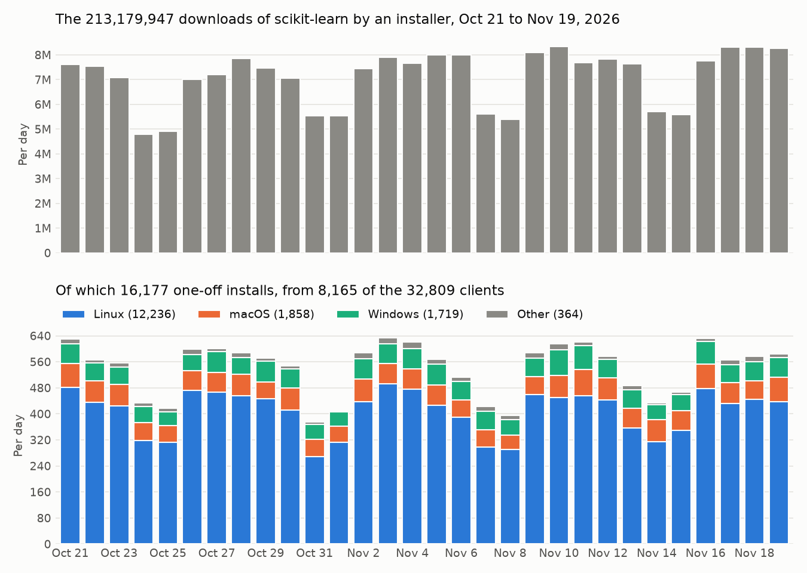
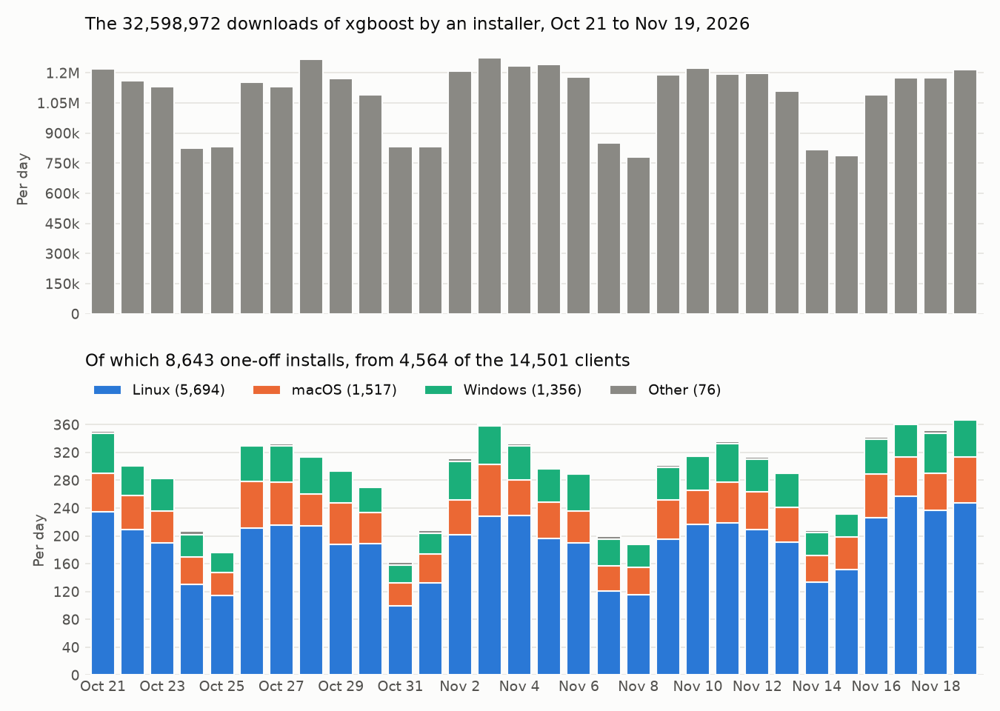
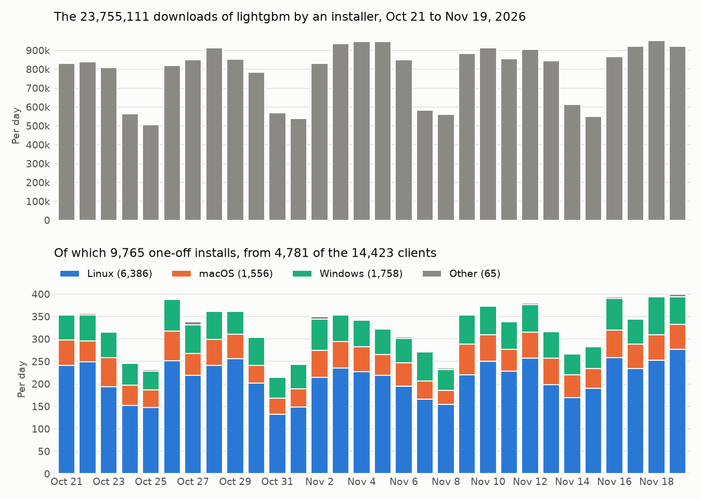
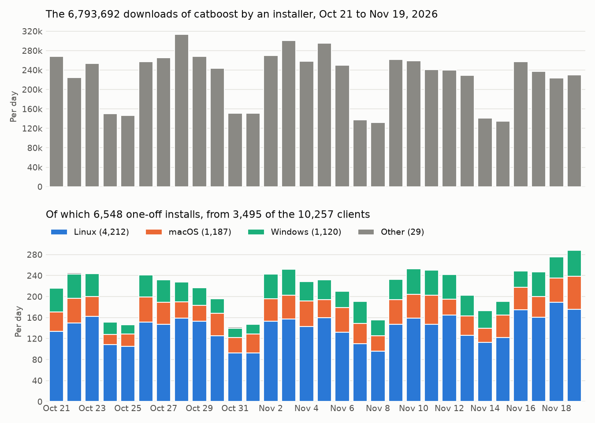
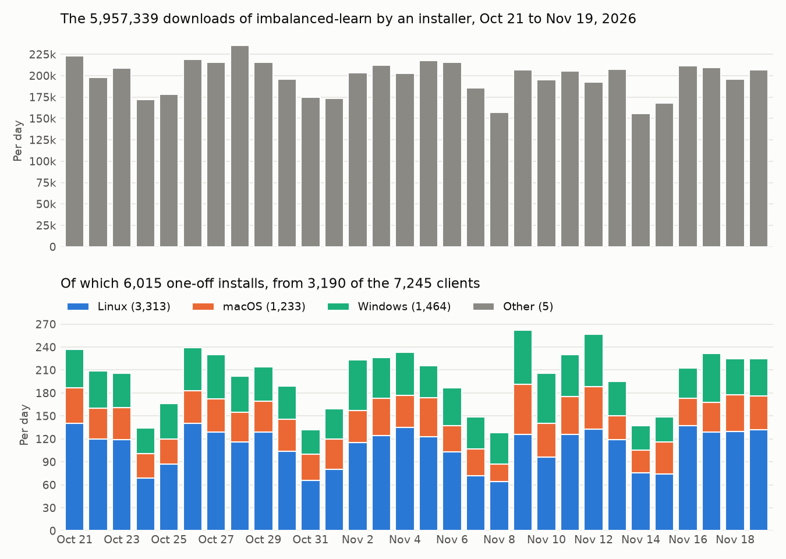
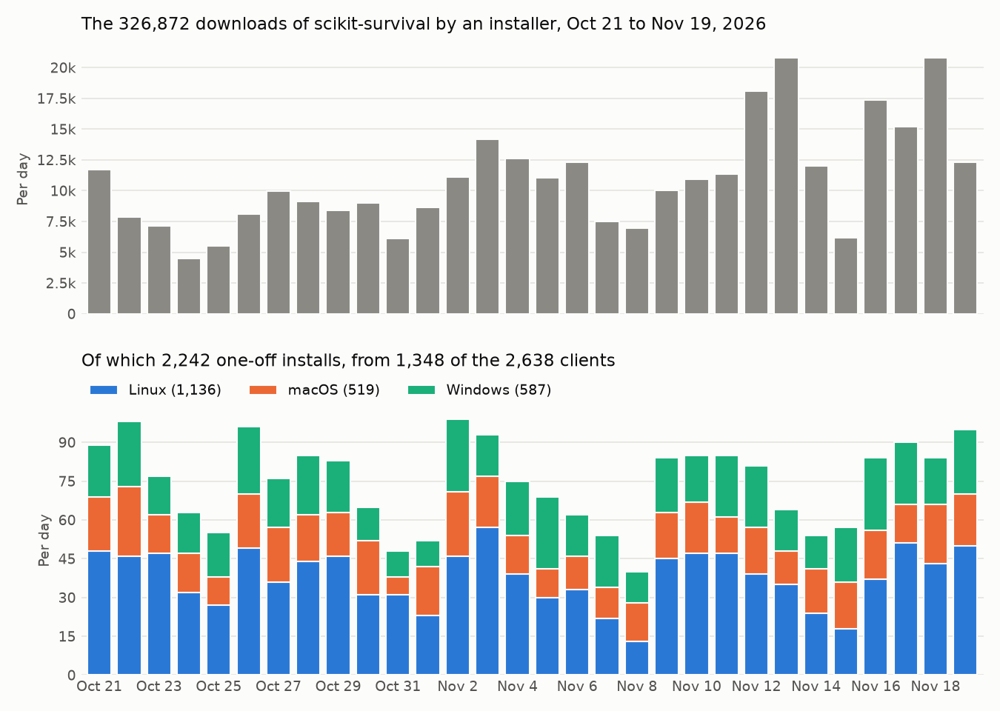
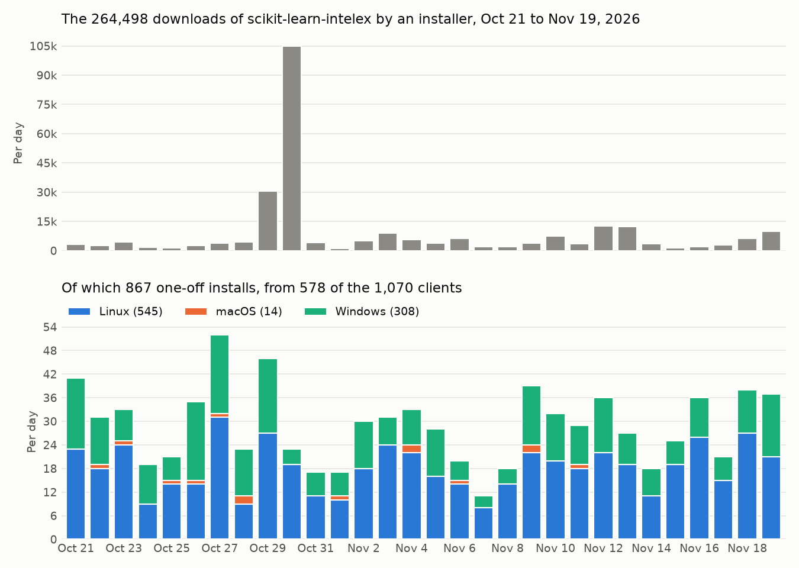
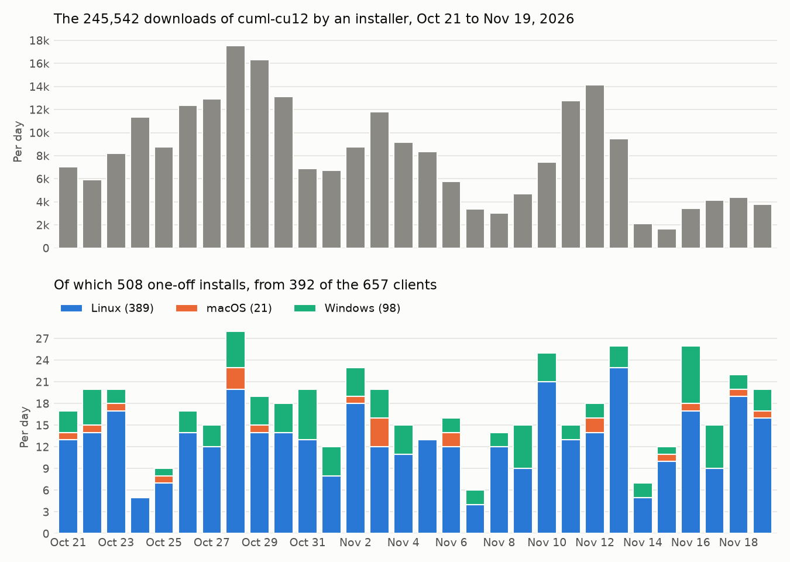
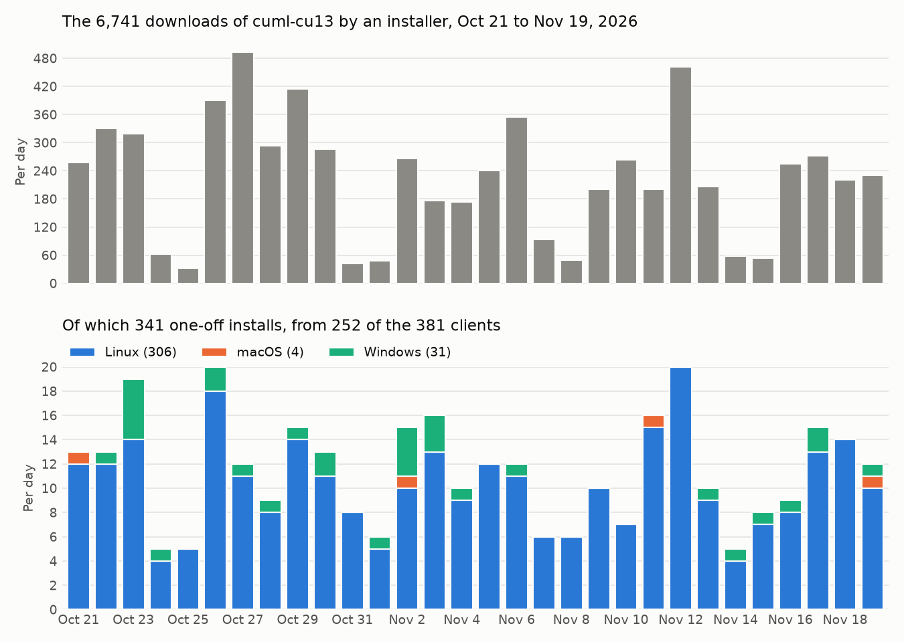

# PyPI installs, 2026-10-21 to 2026-11-19

> [!WARNING]
> This is one possible way to read the PyPI download logs, to try to get
> some insights. The clients are guessed from coarse fingerprints, and the
> split between automated and one-off installs is a heuristic. These
> numbers might not be representative of anything, and they are not counts
> of users. They only cover PyPI: no conda-forge and no other index.

Made with `scripts/pypi-installs/plot_installs.py`, from the public
ClickHouse instance behind https://clickpy.clickhouse.com:

- **Downloads**: all the downloads of the package, mostly mirrors,
  scrapers and CI.
- **By an installer**: the downloads made by pip, uv, poetry, pdm, pixi.
  **In CI** and **By uv** are shares of these downloads.
- **Clients**: the logs have no IP address, so a client is a fingerprint
  (country, installer, OS, Python version, glibc version and CI flag).
  Two people with the same fingerprint are one client.
- **One-off installs**: the downloads of the clients that are not in CI
  and never downloaded more than one file of the package in a day.
  **One-off clients** is the number of these clients.

On a popular package, the common fingerprints (say pip on Linux with
Python 3.12 in the US) have many downloads a day and count as automated.
The one-off installs are then the installs from rare setups: a small and
biased sample, which can't be compared between a small package and a
popular one.

| Package | Downloads | By an installer | In CI | By uv | Clients | One-off clients | One-off installs |
|---|---:|---:|---:|---:|---:|---:|---:|
| [scikit-learn](#scikit-learn) | 217,048,557 | 213,179,947 | 31% | 40% | 32,809 | 8,165 | 16,177 |
| [xgboost](#xgboost) | 33,010,536 | 32,598,972 | 23% | 25% | 14,501 | 4,564 | 8,643 |
| [lightgbm](#lightgbm) | 24,046,260 | 23,755,111 | 33% | 52% | 14,423 | 4,781 | 9,765 |
| [catboost](#catboost) | 6,993,463 | 6,793,692 | 35% | 41% | 10,257 | 3,495 | 6,548 |
| [imbalanced-learn](#imbalanced-learn) | 6,010,687 | 5,957,339 | 6% | 8% | 7,245 | 3,190 | 6,015 |
| [scikit-survival](#scikit-survival) | 338,004 | 326,872 | 24% | 33% | 2,638 | 1,348 | 2,242 |
| [scikit-learn-intelex](#scikit-learn-intelex) | 273,743 | 264,498 | 4% | 5% | 1,070 | 578 | 867 |
| [cuml-cu12](#cuml-cu12) | 304,277 | 245,542 | 21% | 87% | 657 | 392 | 508 |
| [cuml-cu13](#cuml-cu13) | 9,092 | 6,741 | 19% | 48% | 381 | 252 | 341 |

cuML is published on PyPI as one package per CUDA version (`cuml-cu12`,
`cuml-cu13`), and it is also installed with conda, which is not counted here.

With up to 100 one-off installs, the plot has one point per
install. Above that, it shows the downloads by an installer and the
one-off installs per day.

## scikit-learn

## xgboost

## lightgbm

## catboost

## imbalanced-learn

## scikit-survival

## scikit-learn-intelex

## cuml-cu12

## cuml-cu13

