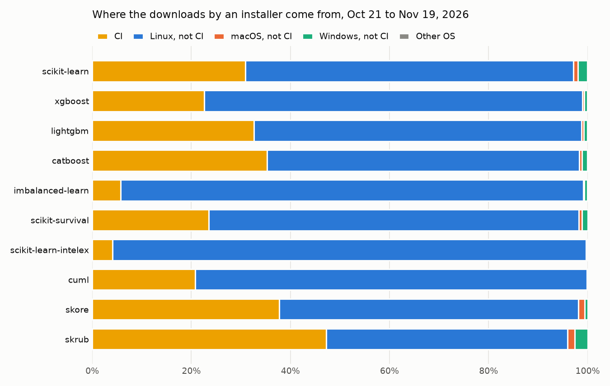
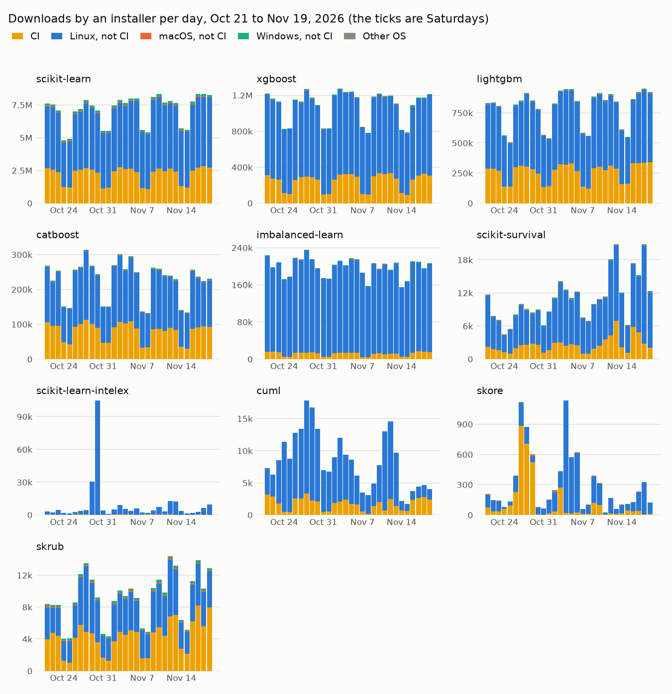
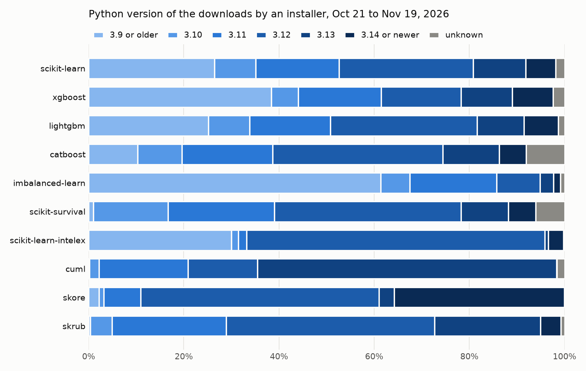
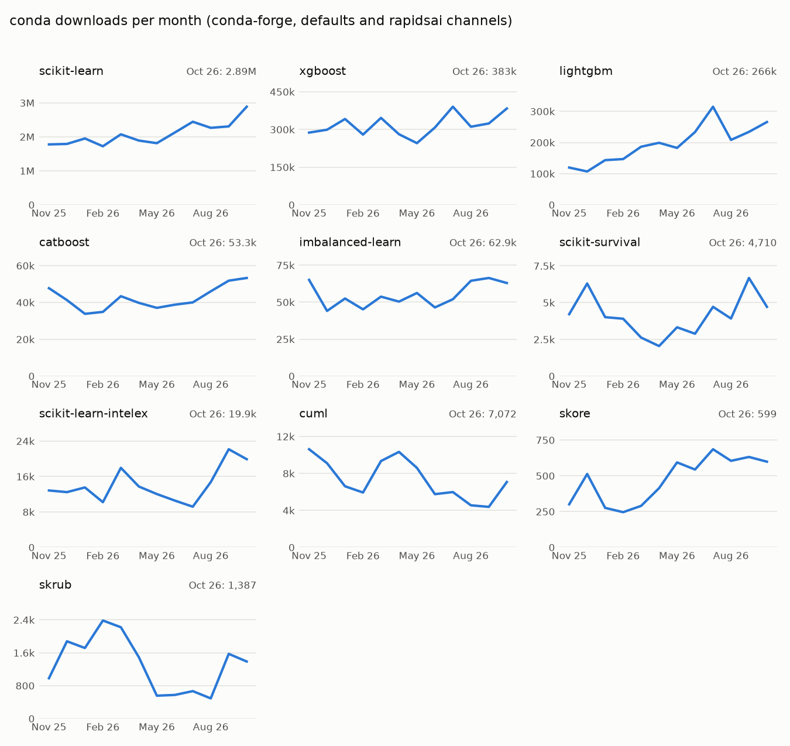
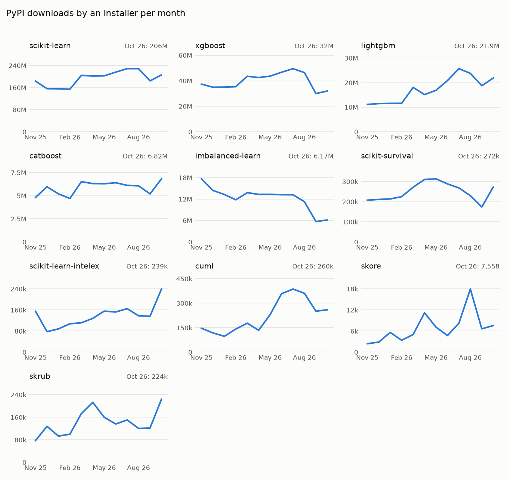

# Who installs scikit-learn and related packages

> [!WARNING]
> This is one possible way to read the public download logs, to try to
> get some insights. Downloads are not users: one CI job or one Docker
> build is a download each time it runs, and a user with a warm cache
> is none. The splits below rely on what the installers report and on
> heuristics. These numbers might not be representative of anything.
> Read the [methods and limits](#methods-and-limits) before quoting one.

PyPI numbers: Oct 21 to Nov 19, 2026 (30 days). Made by
`scripts/pypi-installs/dashboard.py`.

## Summary

| Package | All downloads | By an installer | vs previous 30 days | In CI | Desktop | Desktop per 100 scikit-learn |
|---|---:|---:|---:|---:|---:|---:|
| [scikit-learn](#scikit-learn) | 217M | 213M | +9% | 31% | 6.15M | 100 |
| [xgboost](#xgboost) | 33M | 32.6M | +8% | 23% | 334k | 5.4 |
| [lightgbm](#lightgbm) | 24M | 23.8M | +17% | 33% | 286k | 4.7 |
| [catboost](#catboost) | 6.99M | 6.79M | +9% | 35% | 113k | 1.8 |
| [imbalanced-learn](#imbalanced-learn) | 6.01M | 5.96M | +2% | 5.7% | 54k | 0.88 |
| [scikit-survival](#scikit-survival) | 338k | 327k | +32% | 24% | 5,917 | 0.096 |
| [scikit-learn-intelex](#scikit-learn-intelex) | 274k | 264k | +142% | 4.1% | 741 | 0.012 |
| [cuml](#cuml) | 314k | 253k | +22% | 21% | 268 | 0.0044 |
| [skore](#skore) | 12.5k | 9,174 | +80% | 38% | 171 | 0.0028 |
| [skrub](#skrub) | 287k | 274k | +47% | 47% | 11.2k | 0.18 |

- **All downloads** is the number usually quoted. It includes mirrors and
  scrapers.
- **By an installer**: by pip, uv, poetry, pdm, pixi. All the numbers below
  are about these downloads.
- **In CI**: the installer saw a CI environment variable. Only pip and uv
  report it, so this is a lower bound.
- **Desktop**: downloads from Windows and macOS outside of CI. This is the
  closest thing to people installing the package on their own machine,
  and I think the most comparable number between packages. It misses
  the people on Linux, so it is unfair to Linux-only packages like cuml.

## Who downloads

| Package | CI | Linux, not CI | Desktop | Weekend / weekday | By uv | Fingerprints | Top fingerprint | Top desktop countries |
|---|---:|---:|---:|---:|---:|---:|---:|---:|
| scikit-learn | 31% | 66% | 2.9% | 0.70 | 40% | 32,809 | 18% | US 19%, CN 12%, IN 10% |
| xgboost | 23% | 76% | 1.0% | 0.69 | 25% | 14,501 | 20% | US 18%, IN 17%, CN 12% |
| lightgbm | 33% | 66% | 1.2% | 0.64 | 52% | 14,423 | 16% | US 21%, IN 10%, CN 9.5% |
| catboost | 35% | 63% | 1.7% | 0.56 | 41% | 10,257 | 8.3% | US 16%, IN 10%, CN 6.4% |
| imbalanced-learn | 5.7% | 93% | 0.9% | 0.82 | 7.7% | 7,245 | 46% | IN 20%, US 12%, CN 11% |
| scikit-survival | 24% | 75% | 1.8% | 0.59 | 33% | 2,638 | 13% | US 26%, CN 14%, JP 6.0% |
| scikit-learn-intelex | 4.1% | 96% | 0.3% | 0.19 | 5.2% | 1,070 | 58% | US 17%, JP 12%, DE 7.7% |
| cuml | 21% | 79% | 0.1% | 0.59 | 86% | 901 | 57% | US 11%, CA 11%, CN 10% |
| skore | 38% | 60% | 1.9% | 0.27 | 69% | 272 | 28% | FR 48%, US 9.4%, SG 5.8% |
| skrub | 47% | 49% | 4.1% | 0.45 | 64% | 3,340 | 8.7% | US 21%, CN 7.5%, JP 6.9% |

- **Linux, not CI** mixes servers, containers, cloud notebooks, CI that
  is not flagged and Linux desktops. It can't be split further.
- **Weekend / weekday**: downloads of an average Saturday or Sunday over
  those of an average weekday. Scheduled jobs give 1, people at work
  give a low value.
- **Fingerprints**: number of distinct (country, installer, OS, Python
  version, glibc version, CI flag). **Top fingerprint** is the share of
  the downloads that come from the largest one. A high value on a small
  package means that one machine or one pipeline makes the number (see
  the [details](#details-per-package)).

## What they download

| Package | Latest release | On the latest release | Median release age | Releases older than 2 years | Python 3.9 or older | From source |
|---|---:|---:|---:|---:|---:|---:|
| scikit-learn | 1.9.1 (2026-09-10) | 28% | 14 months | 23% | 26% | 0.5% |
| xgboost | 3.4.1 (2026-08-15) | 9.1% | 21 months | 25% | 38% | 0.2% |
| lightgbm | 4.7.0 (2026-07-18) | 34% | 21 months | 19% | 25% | 2.7% |
| catboost | 1.2.10 (2026-02-18) | 71% | 9 months | 13% | 10% | 1.7% |
| imbalanced-learn | 0.14.2 (2026-06-07) | 19% | 40 months | 73% | 61% | 0.4% |
| scikit-survival | 0.28.0 (2026-07-05) | 44% | 10 months | 15% | 1.0% | 15% |
| scikit-learn-intelex | 2026.2.0 (2026-10-16) | 63% | 1 month | 33% | 30% | 0% |
| cuml | 26.10.0 (2026-10-08) | 1.2% | 7 months | 0.2% | 0.1% | 3.9% |
| skore | 0.29.1 (2026-11-01) | 12% | 1 month | 1.1% | 2.2% | 4.5% |
| skrub | 0.11.0 (2026-10-01) | 13% | 3 months | 0.2% | 0.4% | 0.9% |

- **Median release age**: half of the downloads are of a release older
  than this. Old releases mean pinned environments and old Pythons, more
  than new users.
- **From source**: downloads of the sdist, so no wheel matched the
  platform (or the user asked for a build).

## PyPI and conda per month

Downloads in October 2026, the last month published for conda:

| Package | PyPI, by an installer | conda-forge | Other conda channels | conda share |
|---|---:|---:|---:|---:|
| scikit-learn | 206M | 2.01M | anaconda 874k | 1.4% |
| xgboost | 32M | 273k | anaconda 110k, rapidsai 97 | 1.2% |
| lightgbm | 21.9M | 201k | anaconda 64.5k | 1.2% |
| catboost | 6.82M | 31.5k | anaconda 21.7k | 0.8% |
| imbalanced-learn | 6.17M | 10.6k | anaconda 52.4k | 1.0% |
| scikit-survival | 272k | 4,710 | 0 | 1.7% |
| scikit-learn-intelex | 239k | 3,881 | anaconda 16k | 7.7% |
| cuml | 260k | 0 | rapidsai 7,072 | 2.7% |
| skore | 7,558 | 599 | 0 | 7.3% |
| skrub | 224k | 1,387 | 0 | 0.6% |

The conda numbers have no CI flag and no OS-level detail in common
with PyPI, so the conda share compares all the conda downloads with
all the PyPI downloads by an installer. `anaconda` is the defaults
channel.

## Details per package

### scikit-learn

- Installers: pip 59%, uv 40%, poetry 1.9%, pdm <0.1%.
- Countries, all installers: US 80%, DE 3.1%, SG 2.2%, IN 1.6%, NL 1.6%.
- Countries, desktop: US 19%, CN 12%, IN 10%, JP 4.5%, DE 3.9%.
- Releases: 1.9.1 28%, 1.6.1 20%, 1.7.2 10%, 1.8.0 9.1%, 1.9.0 7.1%.
- Largest fingerprints:
  - 18%: US, pip, Linux, Python 3.9, glibc 2.34
  - 5.1%: US, uv, Linux, Python 3.12, glibc 2.39, CI
  - 4.6%: US, pip, Linux, Python 3.10, glibc 2.35
  - 3.2%: US, pip, Linux, Python 3.7, glibc 2.26
  - 2.5%: US, uv, Linux, Python 3.13, glibc 2.39, CI

### xgboost

- Installers: pip 73%, uv 25%, poetry 2.4%, pdm <0.1%.
- Countries, all installers: US 81%, DE 3.6%, IN 3.2%, NL 2.5%, IE 2.1%.
- Countries, desktop: US 18%, IN 17%, CN 12%, JP 3.6%, KR 3.3%.
- Releases: 2.1.4 35%, 3.2.0 18%, 3.4.1 9.1%, 1.5.1 8.7%, 2.1.3 4.9%.
- Largest fingerprints:
  - 20%: US, pip, Linux, Python 3.9, glibc 2.34
  - 10%: US, pip, Linux, Python 3.7, glibc 2.26
  - 6.7%: US, uv, Linux, Python 3.14, glibc 2.39, CI
  - 5.1%: US, pip, Linux, Python 3.11, glibc 2.35
  - 3.3%: US, pip, Linux, Python 3.8, glibc 2.26

### lightgbm

- Installers: uv 52%, pip 46%, poetry 1.3%, pdm <0.1%.
- Countries, all installers: US 77%, IN 4.2%, DE 3.6%, NL 3.2%, IE 2.3%.
- Countries, desktop: US 21%, IN 10%, CN 9.5%, JP 6.9%, KR 4.5%.
- Releases: 4.6.0 46%, 4.7.0 34%, 4.5.0 9.4%, 3.3.5 2.3%, 4.3.0 2.2%.
- Largest fingerprints:
  - 16%: US, uv, Linux, Python 3.9, glibc 2.34
  - 6.3%: US, pip, Linux, Python 3.12, glibc 2.39
  - 5.4%: US, uv, Linux, Python 3.12, glibc 2.39, CI
  - 2.6%: US, uv, Linux, Python 3.12, glibc 2.43, CI
  - 2.2%: US, pip, Linux, Python 3.9, glibc 2.34

### catboost

- Installers: pip 51%, uv 41%, poetry 8.1%, pdm <0.1%.
- Countries, all installers: US 59%, DE 12%, IN 7.2%, FI 4.5%, NL 2.5%.
- Countries, desktop: US 16%, IN 10%, CN 6.4%, JP 5.4%, KR 4.4%.
- Releases: 1.2.10 71%, 1.2.8 16%, 1.2.7 5.7%, 1.2 1.8%, 1.2.5 1.7%.
- Largest fingerprints:
  - 8.3%: US, uv, Linux, Python 3.12, glibc 2.39, CI
  - 6.1%: DE, poetry, Linux
  - 4.5%: US, pip, Linux, Python 3.12, glibc 2.39
  - 3.4%: IN, pip, Linux, Python 3.9, glibc 2.34
  - 3.3%: FI, pip, Linux, Python 3.12, glibc 2.39

### imbalanced-learn

- Installers: pip 91%, uv 7.7%, poetry 0.8%, pdm <0.1%.
- Countries, all installers: US 87%, IN 5.1%, IE 1.3%, DE 1.1%, NL 0.9%.
- Countries, desktop: IN 20%, US 12%, CN 11%, GB 5.6%, ID 3.7%.
- Releases: 0.11.0 54%, 0.14.2 19%, 0.12.4 9.3%, 0.13.0 3.4%, 0.12.3 3.1%.
- Largest fingerprints:
  - 46%: US, pip, Linux, Python 3.7, glibc 2.26
  - 6.5%: US, pip, Linux, Python 3.9, glibc 2.34
  - 6.2%: US, pip, Linux, Python 3.11, glibc 2.34
  - 2.5%: US, pip, Linux, Python 3.11, glibc 2.41
  - 2.3%: US, pip, Linux, Python 3.9, glibc 2.41

### scikit-survival

- Installers: pip 61%, uv 33%, poetry 6.0%.
- Countries, all installers: US 71%, DE 13%, CA 3.2%, SG 2.1%, FR 1.8%.
- Countries, desktop: US 26%, CN 14%, JP 6.0%, IN 4.7%, SG 3.6%.
- Releases: 0.28.0 44%, 0.27.0 16%, 0.23.1 11%, 0.24.1 9.3%, 0.25.0 7.3%.
- Largest fingerprints:
  - 13%: US, pip, Linux, Python 3.10, glibc 2.35
  - 11%: US, pip, Linux, Python 3.11, glibc 2.34
  - 9.3%: US, pip, Linux, Python 3.12, glibc 2.36
  - 5.7%: US, pip, Linux, Python 3.12, glibc 2.39
  - 5.0%: US, poetry, Linux

### scikit-learn-intelex

- Installers: pip 94%, uv 5.2%, poetry 0.3%.
- Countries, all installers: US 96%, SG 1.0%, DE 0.6%, NL 0.5%, BE 0.3%.
- Countries, desktop: US 17%, JP 12%, DE 7.7%, IN 6.6%, CN 5.3%.
- Releases: 2026.2.0 63%, 2023.2.1 29%, 2024.5.0 1.5%, 2026.1.0 1.2%, 2024.0.1 1.1%.
- Largest fingerprints:
  - 58%: US, pip, Linux, Python 3.12, glibc 2.36
  - 28%: US, pip, Linux, Python 3.9, glibc 2.34
  - 1.8%: US, uv, Linux, Python 3.14, glibc 2.41
  - 1.4%: US, pip, Linux, Python 3.8, glibc 2.26
  - 0.9%: US, pip, Linux, Python 3.14, glibc 2.41

### cuml

PyPI packages: cuml-cu11, cuml-cu12, cuml-cu13.

- Installers: uv 86%, pip 13%, poetry 1.6%.
- Countries, all installers: US 98%, TW 0.4%, GB 0.2%, NL 0.1%, DE 0.1%.
- Countries, desktop: US 11%, CA 11%, CN 10%, IN 9.3%, JP 7.1%.
- Releases: 26.4.0 62%, 26.6.0 18%, 26.2.0 11%, 25.6.0 1.8%, 25.12.0 1.7%.
- Largest fingerprints:
  - 57%: US, uv, Linux, Python 3.13, glibc 2.39
  - 16%: US, uv, Linux, Python 3.11, glibc 2.39, CI
  - 10%: US, pip, Linux, Python 3.12, glibc 2.39
  - 4.1%: US, uv, Linux, Python 3.13, glibc 2.41
  - 1.8%: US, uv, Linux, Python 3.11, glibc 2.35, CI

### skore

- Installers: uv 69%, pip 31%, poetry <0.1%.
- Countries, all installers: US 50%, FR 30%, CN 6.9%, HK 6.1%, SG 1.6%.
- Countries, desktop: FR 48%, US 9.4%, SG 5.8%, NL 4.1%, IN 3.5%.
- Releases: 0.27.0 27%, 0.29.0 24%, 0.28.0 13%, 0.29.1 12%, 0.26.0 3.0%.
- Largest fingerprints:
  - 28%: FR, uv, Linux, Python 3.14, glibc 2.41
  - 23%: US, uv, Linux, Python 3.12, glibc 2.39, CI
  - 6.4%: US, uv, Linux, Python 3.11, glibc 2.43, CI
  - 6.0%: CN, pip, Linux, Python 3.12, glibc 2.41
  - 4.4%: US, pip, Linux, Python 3.12, glibc 2.41

### skrub

- Installers: uv 64%, pip 35%, poetry 0.8%.
- Countries, all installers: US 55%, DE 10%, NL 7.5%, GB 4.5%, SG 3.4%.
- Countries, desktop: US 21%, CN 7.5%, JP 6.9%, KR 5.9%, DE 5.5%.
- Releases: 0.10.1 42%, 0.10.0 19%, 0.11.0 13%, 0.5.3 11%, 0.9.0 9.2%.
- Largest fingerprints:
  - 8.7%: DE, uv, Linux, Python 3.13, glibc 2.39, CI
  - 6.0%: US, uv, Linux, Python 3.12, glibc 2.39, CI
  - 5.2%: US, uv, Linux, Python 3.12, glibc 2.36, CI
  - 4.0%: NL, pip, Linux, Python 3.12, glibc 2.39
  - 3.7%: US, pip, Linux, Python 3.13, glibc 2.39

## Methods and limits

- **Sources.** The PyPI download logs, queried from the public ClickHouse
  instance behind https://clickpy.clickhouse.com. The release dates come
  from the PyPI JSON API. The conda numbers come from the monthly files
  of https://github.com/anaconda/anaconda-package-data.
- **A download is not an install, and not a user.** pip and uv cache the
  wheels: reinstalling in a new environment on the same machine is often
  not a download. A CI job or a Docker build without cache is one each
  time. So the numbers measure how often the package is fetched, mostly
  by machines.
- **By an installer.** The user agent says which tool downloads. Mirrors
  (bandersnatch, Nexus, Artifactory), browsers and scripts are dropped.
  People behind a company mirror are invisible: the mirror downloads
  each file once.
- **CI.** pip and uv report since 2026-01-08 whether a CI environment
  variable is set. poetry, pdm and old pips don't, and a Docker build
  started by CI does not see the variable. So the CI share is a lower
  bound, and **Linux, not CI** still has a lot of automation.
- **Desktop.** Windows and macOS outside of CI. Servers and containers
  almost never run these OSes, so these downloads are mostly from
  laptops and workstations. It still counts each new environment of the
  same person, misses WSL and Linux desktops, and misses conda users.
- **Fingerprints.** The logs have no IP address or user id. Distinct
  fingerprints saturate on a popular package (a few thousand
  combinations exist), so this only tells how spread the downloads are,
  not how many users there are.
- **Countries** are those of the IP address: the US share is mostly
  cloud regions.
- **conda.** Monthly counts per channel, published a few days after the
  end of the month, with CI and mirrors included.
- **Period.** 30 days is short: a release, a holiday or one
  misconfigured pipeline moves the numbers. Check the monthly plots
  before reading a change as a trend.
